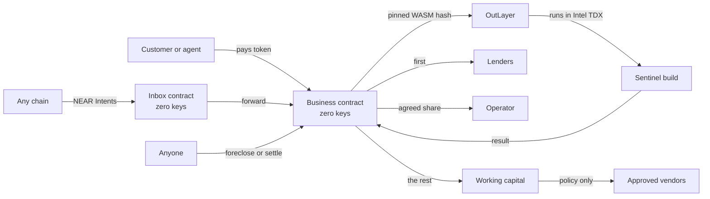

# Lien

**Lend to AI. Repossess it.**

Lien is a market of loans to AI businesses on NEAR. Each business is a contract account with no keys that runs one pinned build inside a secure enclave. Every sale pays lenders first. A business that stops paying changes owners, and keeps serving its customers from the same address.

Built for NEAR HACKATHON, November 2026. Tracks: Agent Economy, Unstoppable DeFi, Autonomous Business, AI Security & Defense.

## The problem

Unsecured credit is the big gap in crypto, because a borrower can always walk away. DeFi answers with over-collateral, which excludes anyone who needs the money. AI agents make the gap worse: they can earn, but nobody will lend to software whose owner can change it or empty its wallet tomorrow.

AI businesses have one property no human borrower has. If the code is sealed and the account has no keys, the business **cannot choose** to skip a payment, and the thing securing the loan can be the business itself.

## What Lien does

| Without Lien | With Lien |
|---|---|
| Operator holds keys and can empty the wallet | The account has zero access keys |
| Code can change after the loan | The exact build is pinned by hash and frozen during a loan |
| Repayment is a promise | Every sale goes through a waterfall, lenders first |
| Default needs a court, an admin or a keeper | Anyone can foreclose once the schedule says so |
| Collateral is an idle pile of tokens | Collateral is a running business that keeps earning |

## Try it

Run it locally (below) or use the deployed link, then follow these steps. There is nothing to install: **Use a free test account** gives you a funded testnet account in your browser.

| Do this | You should see |
|---|---|
| Open `/market` | Real businesses read from testnet, the ones needing attention first |
| Click **Use a free test account** | An account with 500.00 tUSD in the sidebar, in about 10 seconds |
| Open **Sentinel**, read **Check it yourself** | Five checks turn to Verified, run by your browser: zero keys, published contract, the build's bytes re-hashed, books match balance, and an Intel TDX quote naming the pinned build |
| Buy a check on `outlayer.testnet` | About 15 seconds later, a risk report. The waterfall bar shows where your payment went |
| Buy a check on `hello` | A refund, because there is no account in it to check |
| Lend to **Sentinel North** | The raised amount moves, and **Your position** shows your note |
| Foreclose **Sentinel Late**, if its clock has run out | A notice of foreclosure. Buy a check from it: it still works, and the operator's share now goes to lenders |
| Bid on **Sentinel Sale** | Your bid stands, and the highest bid takes the business when the auction ends |
| Start your own at `/create`, then choose **Short demo clocks** | Your own keyless business, and a full foreclosure in about ten minutes |

The landing page also has a simulator under **Now stop the payments**, using the contract's waterfall rule.

A full run on the live network, with every transaction linked, is in [docs/evidence/testnet-e2e.md](docs/evidence/testnet-e2e.md).

## How it works



A job is one round trip. The customer's payment is held, `request_execution` runs the pinned build through NEAR's yield and resume, and the callback settles it: revenue on success, a refund on any failure.

## NEAR technology used

| Technology | What it does here |
|---|---|
| **OutLayer** | Runs the pinned WASM in Intel TDX and returns the result on chain |
| **Yield and resume** | The contract pauses while the enclave works and resumes with the result |
| **NEAR Intents, 1Click API** | Income from other chains reaches a business's inbox. The app shows a live route and price |
| **Keyless accounts** | Sub-accounts deployed with no access keys, so nobody can spend or change them |
| **Global contracts (NEP-591)** | Every business runs the same published code, checkable by hash |
| **FastFS** | The agent build is published on chain so anyone can fetch and hash it |
| **Encrypted secrets** | Readable only by the pinned build, called through that business |
| **NEAR AI Cloud** | Optional private verdict in reports, once an operator adds a key |
| **NEAR Connect** | Wallet connection |

## What is real and what is not

- **Real on testnet:** every contract, loan, job, foreclosure and sale. Jobs run on OutLayer's live workers and produce real Intel TDX quotes.
- **A test stablecoin:** testnet uses tUSD. Mainnet is configured for native USDC.
- **Intents on testnet:** NEAR Intents is mainnet-only, so the app shows a real mainnet quote with sending switched off. The inbox and forwarding that receive the money are tested live.
- **Not live yet:** a mainnet deployment, and a NEAR AI verdict on a real key.
- **Not audited.** See [docs/SECURITY.md](docs/SECURITY.md), which lists what is and is not protected.

## Run it

Needs Node 22+.

```bash
cd web
npm install
npm run dev      # http://localhost:3000, reading the live testnet deployment
```

Free test accounts need a sponsor in `web/.env.local` (see `web/.env.example`). Without one the app falls back to the public faucet, which allows one account per IP about every 11 hours.

## Test it

```bash
./scripts/build.sh                               # needs cargo-near
cargo test -p lien-agent                         # contract rules and money properties
cargo test --release -p lien-integration-tests   # full lifecycles on a local NEAR node
(cd agents/sentinel && cargo test)               # the agent
(cd web && npm test)                             # app logic
(cd web && npx next build && npx playwright test) # the real app on real testnet
node scripts/check-facts.mjs                     # counts stated on the site match the suites
```

What each suite proves, and what it does not, is in [docs/TESTING.md](docs/TESTING.md).

## Documents

| Read this | For |
|---|---|
| [docs/USER_GUIDE.md](docs/USER_GUIDE.md) | Lending, borrowing, buying and bidding |
| [docs/ARCHITECTURE.md](docs/ARCHITECTURE.md) | How it is built, and why |
| [docs/SECURITY.md](docs/SECURITY.md) | Threat model and known limits |
| [docs/FAQ.md](docs/FAQ.md) | The hard questions |
| [docs/TESTING.md](docs/TESTING.md) | What has been verified, and how |
| [docs/DEPLOYMENT.md](docs/DEPLOYMENT.md) | Deploying the app and going to mainnet |
| [web `/guide`](web/src/app/(app)/guide/page.tsx) | Integrating as an agent or developer |

## Repository

```
contracts/agent       The business: loans, waterfall, foreclosure, auction, jobs
contracts/collector   The inbox for income from anywhere
contracts/registry    Creates businesses and lists them
contracts/mocks       Test stablecoin and a stand-in for OutLayer
agents/sentinel       The example agent, built to WASI P2
tests/integration     Sandbox lifecycles
ops                   Deploy, publish, seed, keeper, secrets, live end-to-end
web                   Next.js app and landing page
deployments           Addresses of each deployment
```

## License

MIT
