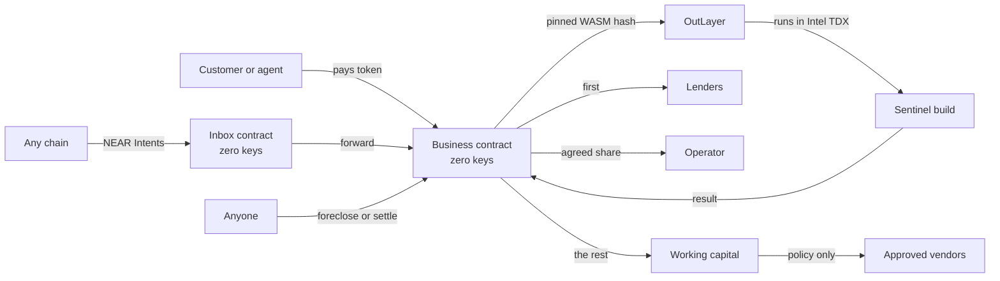

# Lien

**Lend to AI. Repossess it.**

Lien is a market of loans to AI businesses on NEAR. Each business is a contract account with no keys that runs one pinned build inside a secure enclave. Every sale pays lenders first. A business that stops paying changes owners, and keeps serving its customers from the same address.

**Live on testnet: [lien-five.vercel.app](https://lien-five.vercel.app)** · no wallet needed.

**Judging? Start with [JUDGES.md](JUDGES.md):** the two-minute tour, every claim with its test and its testnet transaction, and the honest limits.

## Try to rob it

Each attack below is refused by the contract. Each has a test that proves it; a testnet link is given only where a real transaction exists. Run the checks yourself with `npm run verify` (below).

| Attack | Result | Proven by | On testnet |
|---|---|---|---|
| The operator tries to withdraw the business's money during a loan | **Refused**: "not allowed while a loan is open". The account has zero keys, so nobody can sign for it either | `the_operator_cannot_reach_the_money_during_a_loan` ([tests/integration/tests/lifecycle.rs](tests/integration/tests/lifecycle.rs)) | **Refused live on testnet, during Sentinel's open loan:** [the owner tries](https://testnet.nearblocks.io/txns/AeFjMjMWmdzLeo3NcBw2EFcMqyg6CYSQG7DNRBtwKiXW), [a stranger tries](https://testnet.nearblocks.io/txns/51d7XBw8PS6P6uWQ4zs3k1TdZjZwxeehqEF2CnZPKAXQ). Re-run it yourself: `cd ops && npm run refusals` ([recorded](docs/evidence/refusals-testnet.json)). Zero keys: [creation tx](https://testnet.nearblocks.io/txns/7zfvSeZ3idNUK1gxAtyP4hCLNLA4H1yAkNhT6SfdgUMc) |
| Compromised code tries to pay someone outside the spend policy | **Refused**: the payment is skipped and counted in `spends_blocked`; only approved vendors, within per-payment and daily limits, can be paid | `compromised_code_cannot_pay_anyone_outside_the_policy` (sandbox), `compromised_code_cannot_pay_the_operator` ([contracts/agent/src/tests.rs](contracts/agent/src/tests.rs)) | No blocked payment has happened on testnet: proven by the tests |
| Someone swaps the code mid-loan without lender approval | **Refused**: "not allowed while a loan is open". During a loan a new build applies only when lenders holding more than half the loan approve it | `operator_cannot_change_the_code_during_a_loan`, `a_change_applies_only_when_more_than_half_of_principal_agrees` ([contracts/agent/src/tests.rs](contracts/agent/src/tests.rs)) | **Refused live on testnet:** [the owner tries to swap the code mid-loan](https://testnet.nearblocks.io/txns/AMEa6hDvGLHqTVHfaiMTHp5Tu9sLnDLUEih2D3rdKjnj). The approved path did happen: [owner proposes](https://testnet.nearblocks.io/txns/9X2VEWuuNSmNfkwDyQRSKDyy48VthqZ2uQNNtVt7crmv), [majority lender approves](https://testnet.nearblocks.io/txns/5iG4UPPizMQvJuEkeT8yE4ChTC15KnvkagJzLMYSEyAg) |

The same three are on the app's [/proof](https://lien-five.vercel.app/proof) page.

Built for the NEAR Hackathon, November 2026. Tracks: Agent Economy, Unstoppable DeFi, Autonomous Business, AI Security & Defense.

## The problem

Unsecured credit is the big gap in crypto, because a borrower can always walk away. DeFi answers with over-collateral, which excludes anyone who needs the money. AI agents make the gap worse: they can earn, but nobody will lend to software whose owner can change it or empty its wallet tomorrow.

AI businesses have one property no human borrower has. If the code is sealed and the account has no keys, the business **cannot choose** to skip a payment, and the thing securing the loan can be the business itself.

## What Lien does

| Without Lien | With Lien |
|---|---|
| Operator holds keys and can empty the wallet | The account has zero access keys |
| Code can change after the loan | The exact build is pinned by hash and frozen during a loan |
| Repayment is a promise | Every sale goes through a waterfall, lenders first |
| Default needs a court, an admin or a keeper | Anyone can foreclose once the schedule says so |
| Collateral is an idle pile of tokens | Collateral is a running business that keeps earning |

## Try it

First, check the claims without trusting the app. From the repository root, with Node 22+ and nothing to install, no wallet and no money:

```bash
npm run verify     # or: node scripts/verify.mjs
```

Then open [lien-five.vercel.app](https://lien-five.vercel.app) or run it locally (below), and follow the rest. There is nothing to install: **Use a free test account** gives you a funded testnet account in your browser.

| Do this | You should see |
|---|---|
| Run `npm run verify` at the repository root | Six ✅ lines, read from testnet: Sentinel and its inbox hold zero access keys, it runs the published contract (code hash from `deployments/testnet.json`), its pinned build re-hashes byte for byte from FastFS, the tokens it holds cover its ledger (equal when we ran it), its latest Intel TDX quote names the pinned build, and the live run's evidence file records the operator's withdrawal refused |
| Open `/market` | Real businesses read from testnet, the ones needing attention first |
| Click **Use a free test account** | An account with 500.00 tUSD in the sidebar, in about 10 seconds |
| Open **Sentinel**, read **Check it yourself** | Five checks turn to Verified, run by your browser: zero keys, published contract, the build's bytes re-hashed, books match balance, and an Intel TDX quote naming the pinned build |
| Buy a check on `outlayer.testnet` | About 15 seconds later, a risk report. The waterfall bar shows where your payment went |
| Buy a check on `hello` | A refund, because there is no account in it to check |
| Lend to **Sentinel North** | The raised amount moves, and **Your position** shows your note |
| In the market, open a business marked **Can be taken over** and press **Take over this business** (the market always keeps one: sample businesses on a fast demo clock are restocked every three hours) | A notice of foreclosure. Buy a check from it: it still works, and the operator's share now goes to lenders |
| Open a business marked **For sale** and place a bid (an open auction is always kept available; its clock starts with the first bid) | Your bid stands, and the highest bid takes the business when the auction ends |
| Start your own at `/create`, then choose **Short demo clocks** | Your own keyless business, and a full foreclosure in about ten minutes |

The landing page also has a simulator: set the revenue and the lenders' share, then stop the payments. It runs the contract's waterfall rule.

A full run on the live network, with every transaction linked, is in [docs/evidence/testnet-e2e.md](docs/evidence/testnet-e2e.md).

## How Lien compares

These are good projects, and Incorpr is further along: it is live on mainnet, and Lien is on testnet only.

| Project | What it does |
|---|---|
| Incorpr | Live on mainnet. A keyless AI company can borrow against itself from one lender; while it is pledged, the holder's signing is frozen |
| Loca | Advances against paid orders held in escrow |
| Float | A tranched lending pool for agents |
| **Lien** | A market where up to 50 lenders fund each loan; lenders are paid first from every sale; anyone can foreclose once the schedule allows, with no keeper or admin; a foreclosed business keeps earning for its lenders and is then put up for auction |

More detail, with each difference's test, is in [JUDGES.md](JUDGES.md#how-lien-differs-from-the-closest-entries-we-found).

## Use it from an AI agent

Lien is an MCP server at `https://lien-five.vercel.app/api/mcp`. Any MCP client (Claude, Cursor, an agent framework) can read the market and prepare transactions to lend, buy a job, repay, bid, foreclose or claim. Action tools check the business's state first and return unsigned transactions; the agent signs with its own key and the server never holds one. Plain HTTP readers can use `GET /api/agents` and `/llms.txt`.

```json
{ "mcpServers": { "lien": { "url": "https://lien-five.vercel.app/api/mcp" } } }
```

## The market is live

Every three hours a [scheduled GitHub Action](.github/workflows/heartbeat.yml) has a customer buy one real Sentinel check on testnet: the job runs on the pinned build inside Intel TDX through OutLayer, the report lands on chain, and the sale repays Sentinel's lenders first. Each run's summary in the [Actions tab](https://github.com/Oshioke-Salaki/lien/actions/workflows/heartbeat.yml) links its transaction. It only buys work, so the businesses waiting to be foreclosed or sold stay that way for you to try.

## Revenue on other chains

A business can also hold money on another chain without anyone holding a key to it. `contracts/xvault` is a small, separate contract deployed per business with no access keys. Through NEAR Chain Signatures (`v1.signer-prod.testnet`, path `evm-1`) it controls one EVM address, and it builds every transaction itself: it will only have the MPC network sign a transfer on Base Sepolia (chain id 84532) to one settlement address fixed at init. Another recipient, another chain or any contract call is refused on NEAR before the signer is asked. Sentinel's vault is `sentinel-x.v1.lien-13569.testnet`, controlling [`0x7004…8546`](https://sepolia.basescan.org/address/0x700441434653017a1faa40107382cff2b6248546): [created with no key](https://testnet.nearblocks.io/txns/BnePWEP4dsThAg4zw2GD9XbE26kGkxa1Nmha9xF2XX73), [a transfer elsewhere refused](https://testnet.nearblocks.io/txns/8iSsZzTiWLeHLYy8nezqSvicz98C4f2JraBd9b6cLrtV), and [a transfer to the settlement address signed by MPC](https://testnet.nearblocks.io/txns/unu5o2Jaub6VqzTZVTpXrfBWifTwMMAShbL1oUSJ3c8). That signed transfer has not reached Base Sepolia yet, because the vault holds no test ETH. Details and limits are in the [evidence](docs/evidence/testnet-e2e.md#chain-signatures-revenue-on-base-sepolia-that-can-only-go-one-way); run it with `cd ops && npx tsx src/xvault.ts address|sign|send|refuse`.

## How it works



A job is one round trip. The customer's payment is held, `request_execution` runs the pinned build through NEAR's yield and resume, and the callback settles it: revenue on success, a refund on any failure.

## NEAR technology used

| Technology | What it does here |
|---|---|
| **OutLayer** | Runs the pinned WASM in Intel TDX and returns the result on chain |
| **Yield and resume** | The contract pauses while the enclave works and resumes with the result |
| **NEAR Intents, 1Click API** | Income from other chains reaches a business's inbox. The app shows a live route and price |
| **Chain Signatures** | A keyless vault controls an EVM address and has the MPC network sign only transfers to one fixed address on Base Sepolia |
| **Keyless accounts** | Sub-accounts deployed with no access keys, so nobody can spend or change them |
| **Global contracts (NEP-591)** | Every business runs the same published code, checkable by hash |
| **FastFS** | The agent build is published on chain so anyone can fetch and hash it |
| **Encrypted secrets** | Readable only by the pinned build, called through that business |
| **NEAR AI Cloud** | Optional private verdict in reports, once an operator adds a key |
| **NEAR Connect** | Wallet connection |

## What is real and what is not

- **Real on testnet:** every contract, loan, job, foreclosure and sale. Jobs run on OutLayer's live workers and produce real Intel TDX quotes.
- **A test stablecoin:** testnet uses tUSD. Mainnet is configured for native USDC.
- **NEAR Intents is a quote only.** Intents has no testnet, so the app asks the mainnet 1Click API for a live route and price as a dry run, with sending switched off: no Intents payment has reached a Lien inbox. The inbox and its forwarding into the waterfall are tested live with a plain transfer, which is what an Intents payout looks like.
- **Chain Signatures is a narrow vault, not yet proven end to end.** The keyless vault, its refusals and an MPC signature are on testnet; the signed transfer has not been broadcast to Base Sepolia because the vault holds no test ETH. The settlement address is held by the Lien team, and nothing yet moves money from it into the business's inbox.
- **Not live yet:** a mainnet deployment, and a NEAR AI verdict on a real key.
- **Not audited.** See [docs/SECURITY.md](docs/SECURITY.md), which lists what is and is not protected.

## Run it

Needs Node 22+.

```bash
cd web
npm install
npm run dev      # http://localhost:3000, reading the live testnet deployment
npm run verify   # the same read-only claim checks as at the root
```

Free test accounts need a sponsor in `web/.env.local` (see `web/.env.example`). Without one the app falls back to the public faucet, which allows one account per IP about every 11 hours.

## Test it

```bash
./scripts/build.sh                               # needs cargo-near
cargo test -p lien-agent                         # contract rules and money properties
cargo test -p lien-xvault                        # the Chain Signatures vault's policy and payloads
cargo test --release -p lien-integration-tests   # full lifecycles on a local NEAR node
(cd agents/sentinel && cargo test)               # the agent
(cd web && npm test)                             # app logic
(cd web && npx next build && npx playwright test) # the real app on real testnet
node scripts/check-facts.mjs                     # counts stated on the site match the suites
```

What each suite proves, and what it does not, is in [docs/TESTING.md](docs/TESTING.md).

## Documents

| Read this | For |
|---|---|
| [docs/USER_GUIDE.md](docs/USER_GUIDE.md) | Lending, borrowing, buying and bidding |
| [docs/ARCHITECTURE.md](docs/ARCHITECTURE.md) | How it is built, and why |
| [docs/SECURITY.md](docs/SECURITY.md) | Threat model and known limits |
| [docs/FAQ.md](docs/FAQ.md) | The hard questions |
| [docs/TESTING.md](docs/TESTING.md) | What has been verified, and how |
| [docs/DEPLOYMENT.md](docs/DEPLOYMENT.md) | Deploying the app and going to mainnet |
| [web `/guide`](web/src/app/(app)/guide/page.tsx) | Integrating as an agent or developer |

## Repository

```
contracts/agent       The business: loans, waterfall, foreclosure, auction, jobs
contracts/collector   The inbox for income from anywhere
contracts/registry    Creates businesses and lists them
contracts/xvault      Keyless Chain Signatures vault: Base Sepolia transfers to one fixed address
contracts/mocks       Test stablecoin and a stand-in for OutLayer
agents/sentinel       The example agent, built to WASI P2
tests/integration     Sandbox lifecycles
ops                   Deploy, publish, seed, keeper, secrets, live end-to-end
web                   Next.js app and landing page
deployments           Addresses of each deployment
```

## Disclosures

- **Written during the hackathon.** The first commit is from 4 November 2026; nothing predates the build window.
- **Libraries:** near-sdk (Rust contracts), cargo-near, near-workspaces (sandbox tests), proptest, near-api-js, @hot-labs/near-connect (wallets), Next.js, React, Tailwind CSS, Vitest and Playwright. OutLayer, FastFS, NEAR Intents 1Click and NEAR AI Cloud are used as services.
- **Design kit:** the landing page is built on the MIT-licensed [taste-skill](https://github.com/Leonxlnx/taste-skill) design system, whose CSS, scripts and fragments are vendored under `web/public/site/assets`.
- **AI-generated code:** much of the code, tests and documents were written with an AI coding assistant, then run, tested and reviewed by the author. Every claim in this repository is backed by a test or a linked transaction.

## License

MIT
