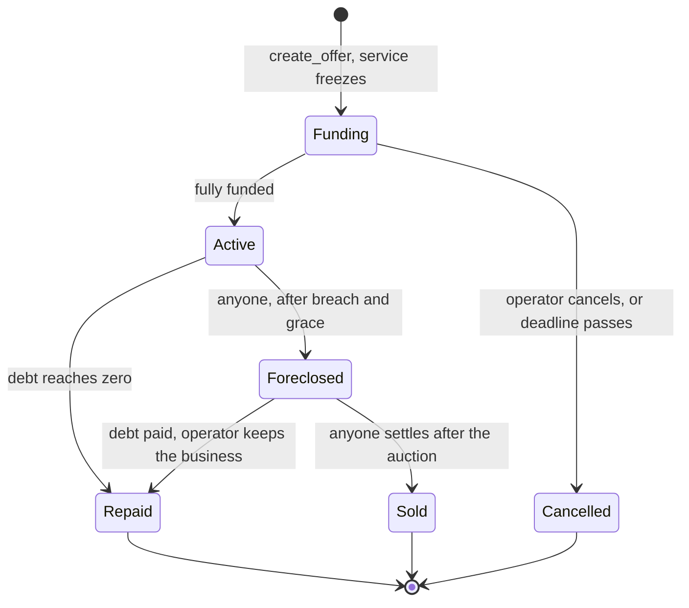

# Architecture

## The contracts

**One contract per business.** Each is its own sub-account holding only its own money, so a bug or a dispute in one cannot reach another. There is no shared pool to drain.

| Contract | Holds | Job |
|---|---|---|
| `agent` | Everything for one business | Loan, waterfall, foreclosure, auction, jobs, spending |
| `collector` | Nothing for long | Sends any balance it receives to its agent as revenue |
| `registry` | Nothing | Creates the pair and lists them |

All are deployed with no access keys except the registry, whose key is held during development. Businesses cannot be upgraded by anyone.

## Why this design

**Spending power comes from the code hash, not a key.** The pitch for Lien started with an OutLayer custody vault whose parent is a contract. The vault's source does allow that, but its exit window is at least a day and unlocking is one-way, so foreclosure would take days. Instead the contract itself pins the WASM hash, calls OutLayer and acts on the result. There is no key to hand over, and foreclosure is one state change.

**A separate inbox, because of a real double count.** The obvious way to detect plain transfers is to compare the contract's balance with its ledger. That is unsafe: `ft_transfer_call` credits the balance one receipt before `ft_on_transfer` runs, so a balance read between them counts that money twice, once as new income and once when the call lands. The inbox has no ledger, so there is nothing to double count, and all money enters the agent through one door.

**Breach is calculated, not stored.** `breach_time(repaid)` derives from the schedule and what lenders have received. Nobody has to call anything for the clock to start, and a payment cures a breach by itself.

**The covenant counts money to lenders, not revenue.** So wash trading to meet a covenant simply repays the loan.

**Every payout has one path.** Money owed goes to a per-account credit, then gets pushed. If the push fails (the recipient has no token account) the credit returns and can be withdrawn later. No recipient can block a job, a repayment or a foreclosure.

## The waterfall

```
inflow
 ├─ lenders:  lender_bps of it, capped at what is still owed
 ├─ operator: operator_bps of it
 └─ the rest: working capital
```

While behind or foreclosed, the operator's share goes to lenders. Only the pure functions in `contracts/agent/src/math.rs` decide this, and they are property-tested for conservation. `web/src/lib/math.ts` is a port tested against the same cases.

## Life of a loan



On foreclosure the operator's share and any working capital above 7 days of allowed spending go to lenders. The rest stays so the business can run.

## A job

1. The customer calls `ft_transfer_call` on the token. The price moves to `job_escrow`, and change returns.
2. The agent calls `request_execution` on OutLayer with the pinned hash. This is deliberately not returned to the token, so the customer's transfer is final and settlement cannot be confused with a token refund.
3. OutLayer's worker runs the build in Intel TDX and resolves the yield.
4. `on_job_result` settles it. It never panics, because a panic would strand the escrow. Any failure refunds the customer.
5. If the callback is ever lost, anyone can call `expire_job` after an hour.

Only success becomes revenue, and spending happens after revenue, so a spend cannot reach what lenders are owed.

## Trust boundaries

- **On chain, enforced by the contract:** the waterfall, the schedule, foreclosure, the freeze, the spending policy.
- **Enforced by OutLayer:** that the bytes run match the pinned hash, inside an approved enclave. The contract accepts results from `outlayer.near` and does not verify TDX quotes itself. Anyone can verify them afterwards, and the app does.
- **Off chain, unenforced:** that the code is any good. Lenders read it, or do not lend.

## The app

Next.js and Tailwind. It reads the chain straight from the browser with no database and no indexer, so nothing on screen depends on a Lien server. The server only holds what cannot be public: the guest sponsor key and an optional Intents partner key.

A token transfer reports success even when the receiver refused the money and the token refunded it. `web/src/lib/near/outcome.ts` reads the receipts to tell the user what really happened.
